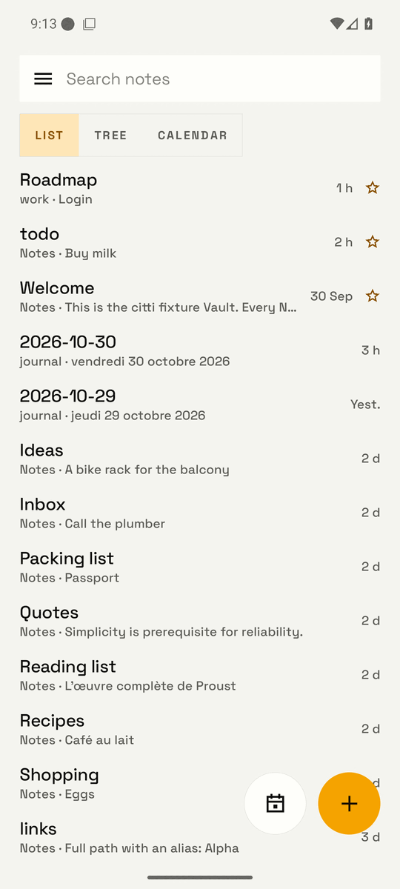
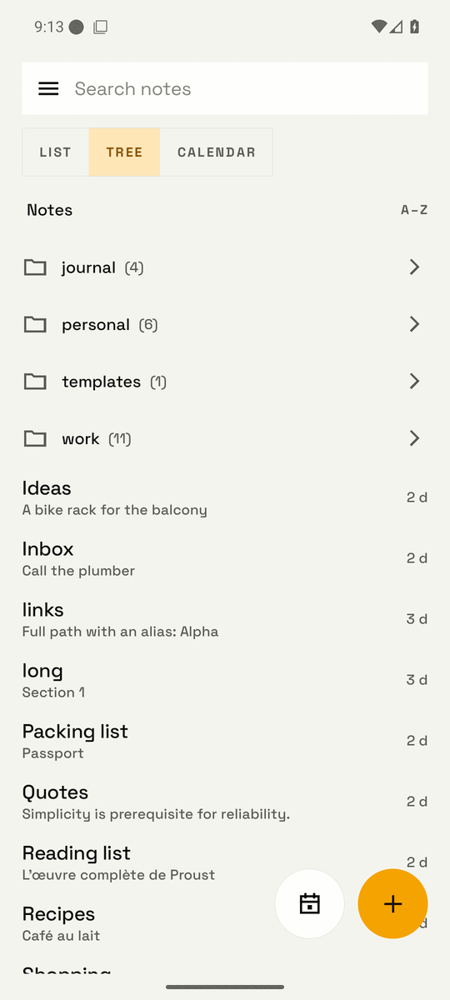
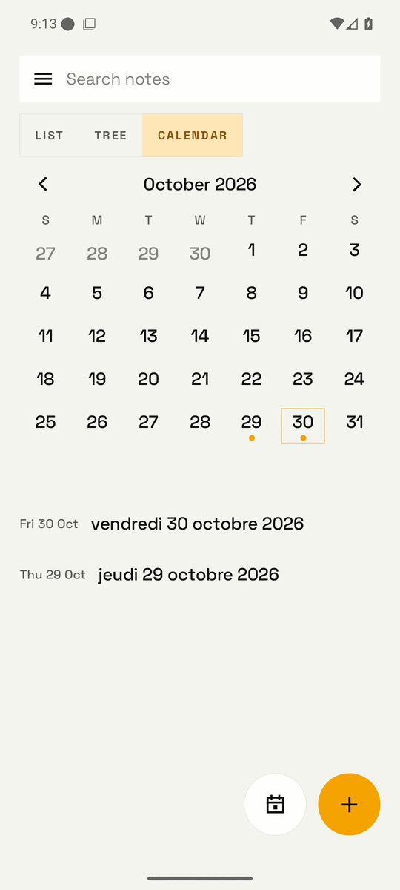
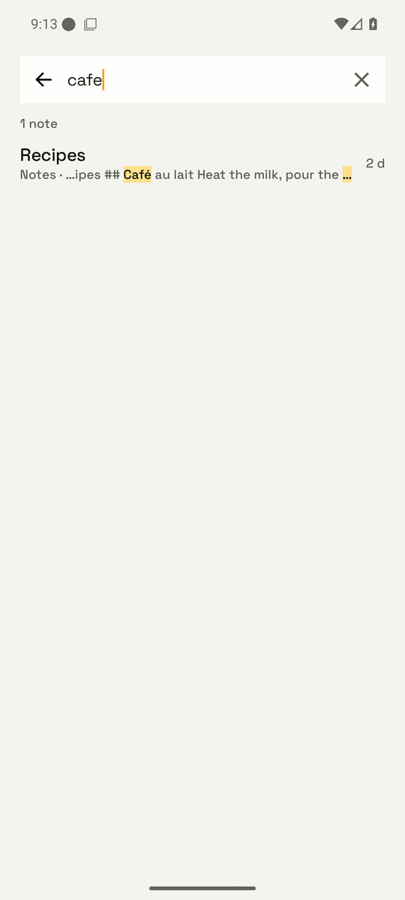
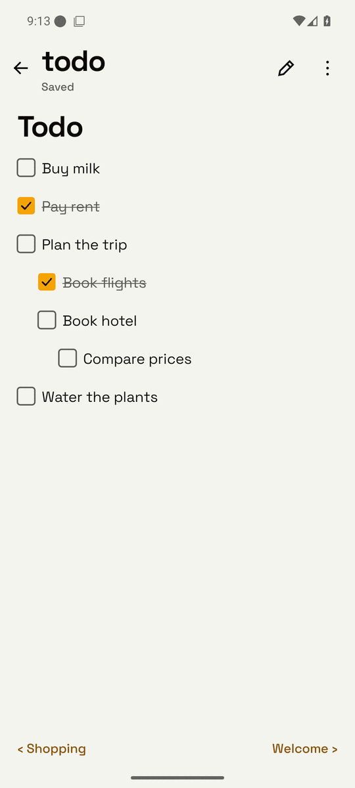
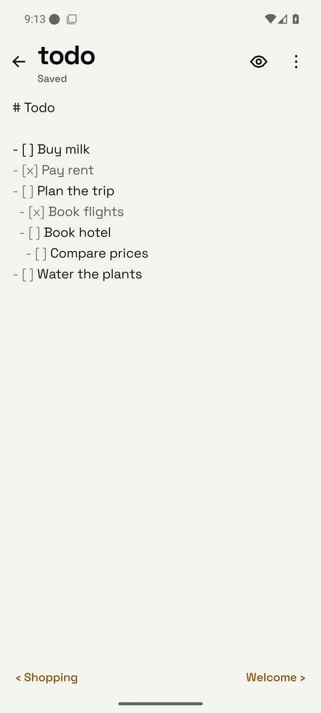
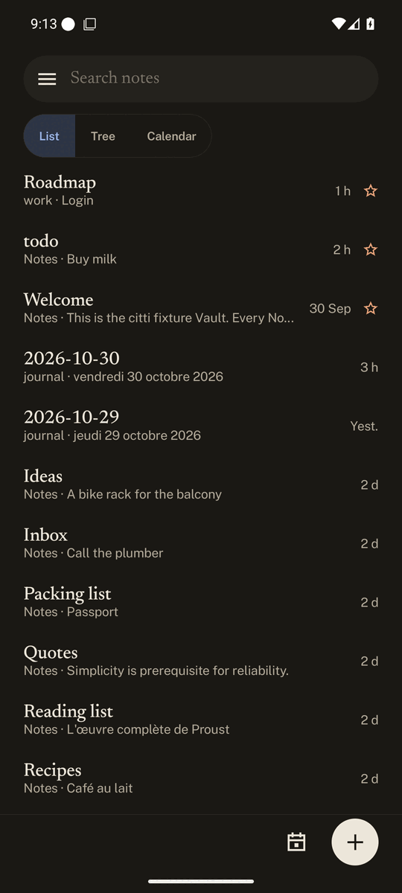

# citti

An Android note app for a [Nextcloud Notes](https://github.com/nextcloud/notes) server. Text and favorites sync through the Notes API, images through WebDAV. It keeps every Note on the phone, so browsing, searching and editing work offline, and it is built to cope with large Vaults (thousands of Notes, Obsidian-style folders and image links). Kotlin Multiplatform and Compose Multiplatform; an iOS app is planned.

<p>
  
  
  
  
</p>
<p>
  
  
  
</p>

The screenshots come from the end-to-end tests, against a fake server and a made-up Vault.

## Features

- **Offline-first sync.** The local database feeds the UI and the widgets. A sync with nothing new is a single `304`; edits made offline are queued and pushed later. When the server changed a Note meanwhile, the server wins and your text is kept as a Conflict copy.
- **List, Tree and Calendar.** Favorites first, then by last change; or browse the Folders; or pick a day. The last mode is remembered.
- **Search** over the full text of every synced Note, accent-insensitive, with the match highlighted.
- **Preview and Edit.** Notes open as rendered markdown: images (fetched over WebDAV and resolved the way Obsidian does), `|width`, tappable `[[wikilinks]]` and checkboxes, folded frontmatter. Double tap to edit the raw markdown, which citti never rewrites. Insert an image from the camera or the gallery.
- **Daily notes.** A Today button and a Calendar over your journal Folder, created from an Obsidian-style Template (`{{date:…}}`, Moment.js tokens). The Journal folder, Template and date format can be imported from Obsidian.
- **Widgets.** One Note, ready to read and edit; your Favorites with today's Daily note first; today's Daily note.
- **Exclusions.** An Unsynced folder is never downloaded or searched; a Hidden folder is synced and searchable but not listed.
- **Appearance.** Three themes (Signal, Paper, Index), each light and dark, Dynamic color, and one Custom theme made of a base theme plus your overrides (colors, fonts, density, shapes), with import and export.
- **Sign in** with Login Flow v2 (approve in the browser) or with an app password. Credentials are stored encrypted.

## Build

Requires JDK 17 and the Android SDK (`sdk.dir` in `local.properties` or `ANDROID_HOME`).

```sh
./gradlew spotlessCheck check assembleDebug
```

The debug APK lands in `androidApp/build/outputs/apk/debug/`. The end-to-end tests run on a Gradle-managed emulator against a fake server: `./gradlew e2e`.

To regenerate the screenshots above, run `./gradlew e2e -Pe2e.screenshots` and copy the PNGs from `androidApp/build/intermediates/managed_device_android_test_additional_output/debugAndroidTest/api36GoogleDebugAndroidTest/screenshots/` to `docs/screenshots/` (downscaled to 540 px wide).

## Layout

- `core`: shared Kotlin (models, Ktor, SQLDelight, sync)
- `core-testing`: the fake Nextcloud server and the Fixture Vault, for tests only
- `ui`: Compose Multiplatform theme and components
- `androidApp`: the Android application
- `docs/adr`: architecture decision records; `GLOSSARY.md`: the project's terms

## License

[Apache-2.0](LICENSE). The bundled fonts are under the SIL Open Font License, see `licenses/fonts/`. The Moment.js locale tables and week rules in `core/.../daily/` are copied from Moment.js (MIT), see `licenses/moment/`.
